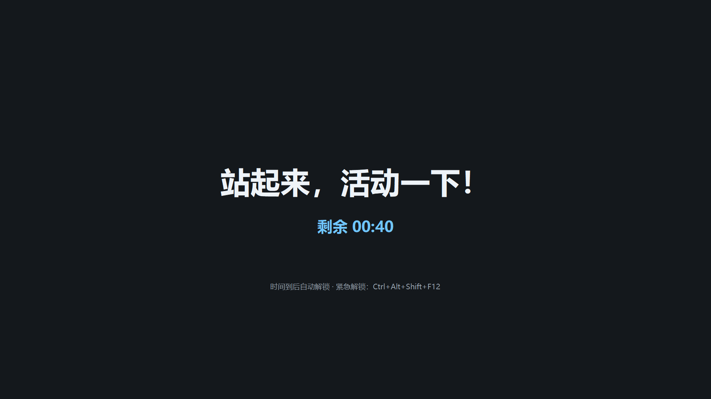
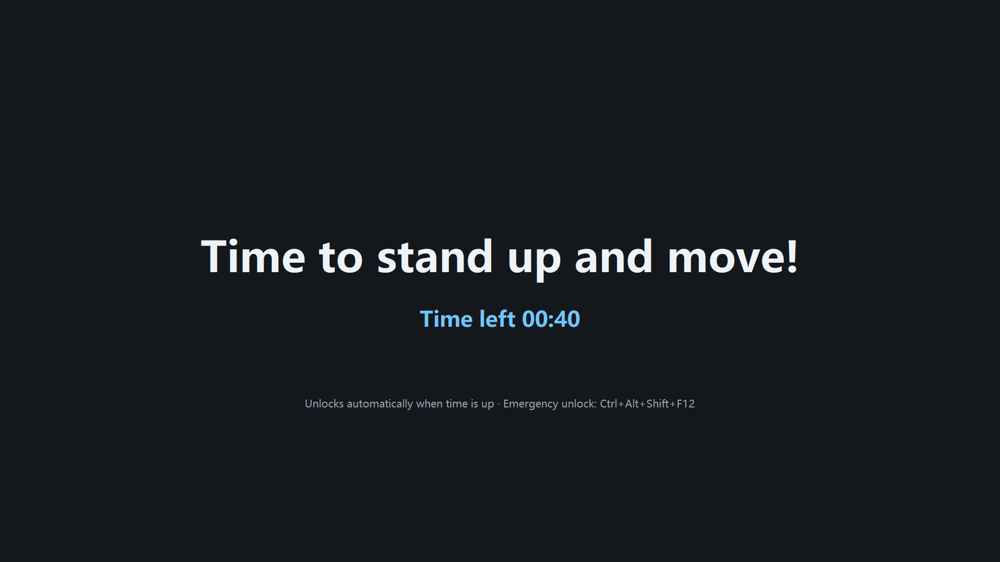

# Liftly
Stand for a while

English | [中文](README.md)

Liftly (站会儿) is a small always-on Windows desktop tool: after you work for a while it locks the keyboard and mouse and covers every display with a full-screen dark overlay; when the break ends it unlocks automatically. There is a single `liftly.exe`, it never talks to the network, and it lives in the system tray.

## Who it is for: a helper for lower-back pain

People who sit for long stretches often forget to stand up, and their lower back gets sore. Liftly follows the rhythm you set and makes you leave the chair at regular intervals so your back can relax. It does not treat back pain and it does not replace a doctor's diagnosis or rehab advice; if the pain continues or gets worse, see a doctor.

## Features

- Before lock, a reminder window pops up in the bottom-right corner and counts down every second (click to dismiss; if the popup cannot be created it falls back to a tray balloon).
- By default a compact always-on-top countdown bubble sits in the top-right of the work area (about 134×32 at 96 DPI and 100% scale): light-green background, thin green border and small rounded corners by default. A single line updates every second with “距休息 MM:SS” (or “Break in MM:SS” in English), and the Liftly icon sits on the right. While paused it shows “已暂停 MM:SS” / “Paused MM:SS” and uses that skin's paused colors. It hides during breaks and while the workstation is locked, and it does not steal focus. Hover the bubble edge for a resize cursor and drag to change size (50%–300%); dragging the middle still moves it. On release it clamps to the nearest monitor work area and saves to the INI. You can hide it, resize it, or switch skins (fresh green / sky blue / warm orange / dark / sakura pink) from the tray menu; those choices persist.
- During a break it enumerates every monitor, creates a topmost full-screen overlay on each, and shows the reminder and remaining break time in the center. English copy is “Time to stand up and move!”, “Time left MM:SS”, and “Unlocks automatically when time is up” (plus the emergency-unlock chord when that option is on).
- Low-level keyboard and mouse hooks block input during the break; time-up unlocks automatically.
- The tray context menu has presets for work, break, and warning durations, plus bubble size (small / standard / large / larger / extra large) and bubble skin (fresh green / sky blue / warm orange / dark / sakura pink). “自定义…” or “设置…” lets you type any legal duration and toggle the unlock options; double-clicking the tray icon also opens Settings.
- The entire UI is available in Chinese and English. Choose “English” under “Language” in Settings and save: the tray menu, tray tips and balloons, Settings window, reminder popup, error dialogs, desktop bubble, and lock-screen overlay all switch immediately without resetting the timer. “System default” follows the Windows display language.
- Timing pauses while the workstation is locked; unlocking or waking from sleep starts a fresh full work period.
- Emergency unlock: during a break, hold Ctrl, Alt, and Shift (either side) and press F12 to end the break early (on by default, can be turned off).
- Driven by a monotonic clock and a single `SetTimer`; no polling while idle.

All UI copy follows `language` and can be changed in Settings; the desktop bubble and lock-screen overlay use the same setting.

## Screenshots

Desktop countdown bubble while working (`docs/images/bubble.png`):


Desktop countdown bubble with the English interface (`docs/images/bubble-en.png`):


Full-screen overlay during a break (`docs/images/lock-screen.png`, one monitor):



Full-screen overlay with the English interface (`docs/images/lock-screen-en.png`, one monitor):



## Running

After you download or build it, put `liftly.exe` in any folder and double-click. There is no main window; it sits in the tray. Within about one second a “站会儿已启动” balloon shows the current work/break durations and says that right-clicking the tray icon opens settings and double-clicking opens the Settings window; the countdown bubble also appears in the top-right of the work area. If startup fails (for example the main window or tray icon cannot be created), an error dialog appears; the process does not exit silently. To quit, use “退出” on the tray context menu.

`liftly.ini` must sit in the same folder as `liftly.exe`. Missing files use the defaults; unknown keys and illegal values are ignored.

Changes from the tray take effect immediately and are saved to `liftly.ini`, keeping comments and other settings. Unchanged command-line overrides are not written back. Saving while working restarts the work timer; while paused it stays paused and resets the work duration; an in-progress break is left alone. Dragging the bubble only saves position; dragging an edge to resize only saves size and (when the top-left corner moved) position; neither resets the timer. “显示桌面倒计时”, “气泡大小”, and “气泡皮肤” on the tray menu only affect the bubble and also do not reset the timer. If saving fails, a tray balloon still appears and the change stays in effect for this run. The timer keeps running while the Settings window is open; when a break starts the window is closed and unsaved edits are discarded.

## Settings

| Key | Default | Range | Description |
| --- | --- | --- | --- |
| `work_minutes` | `45` | `1..=600` | Work duration (minutes) |
| `break_minutes` | `5` | `1..=120` | Break duration (minutes) |
| `warn_seconds` | `60` | `0..=600` | Seconds to warn before lock; `0` means no warning. Values greater than or equal to the work duration are truncated to work duration minus 1 second |
| `reset_on_unlock` | `true` | `true/false` | Pause timing while locked; start a fresh full work period after unlock or wake |
| `emergency_unlock` | `true` | `true/false` | During a break, allow Ctrl+Alt+Shift (either side) and F12 to unlock early |
| `show_bubble` | `true` | `true/false` | Show the desktop countdown bubble; always hidden during breaks and while locked |
| `bubble_position` | `auto` | `auto` or `x,y` | Top-left of the bubble; `auto` means top-right of the work area. Saved on drag; off-screen positions are clamped back into the visible work area |
| `bubble_scale` | `100` | `50..=300` | Bubble size percent; `100` is the standard size. The tray menu can switch 80/100/125/150/200, or you can drag the bubble edge |
| `bubble_theme` | `green` | `green`/`blue`/`orange`/`dark`/`pink` | Bubble skin; the tray menu can switch fresh green, sky blue, warm orange, dark, or sakura pink. Illegal values are ignored |
| `language` | `auto` | `auto`/`zh`/`en` | UI language. `auto` follows the Windows display language (Chinese on a Chinese UI, English otherwise). The tray menu, Settings window, reminder popup, error dialogs, desktop bubble, and lock-screen overlay all follow this setting; change it under “Language” in Settings. Saving other settings does not append this key |

`liftly.ini` uses a simple `key = value` format. Lines starting with `#` or `;` are comments. See `liftly.ini.example` in the same folder:

```ini
# Work duration (minutes), 1-600
work_minutes = 45

# Break duration (minutes), 1-120
break_minutes = 5

# Warning seconds before lock, 0-600; 0 means no warning
warn_seconds = 60

# Pause while locked; start a fresh full work period after unlock or wake
reset_on_unlock = true

# Allow Ctrl+Alt+Shift (either side) and F12 as emergency unlock
emergency_unlock = true

# Show the desktop countdown bubble
show_bubble = true

# Bubble position: auto (top-right of the work area) or x,y (for example 1200,80); saved after drag
bubble_position = auto

# Bubble size percent, 50-300; 100 is the standard size
bubble_scale = 100

# Bubble skin: green/blue/orange/dark/pink
bubble_theme = green

# UI language: auto (follow Windows) / zh / en; applies to every UI surface and can be changed in Settings
language = auto
```

## Command-line arguments

Command-line arguments override the same keys in `liftly.ini`:

```text
liftly.exe --work 45 --break 5 --warn 60
```

`--work=45` is also accepted. Illegal or out-of-range values are ignored, and the file/default value is kept.

## Start with Windows

Open the Settings window from the tray, check “开机自启动”, and save. Liftly will run at the next Windows sign-in. This writes the current user's Run key (`Liftly` under `HKCU\Software\Microsoft\Windows\CurrentVersion\Run`). It does not need administrator rights and is not stored in `liftly.ini`.

After you move `liftly.exe`, open Settings and check the box once more so the startup path is updated.

If you previously put a shortcut in the Startup folder, delete it so the app does not start twice. Even if you leave it, a second instance launched with `--autostart` exits silently and does not show “站会儿已经在运行”.

## Resource use

- The whole program is one hidden message window, one tray icon, one desktop countdown bubble, and on-demand reminder popups and overlay windows.
- The main loop uses a single `SetTimer`: while the desktop bubble is shown during work it refreshes every second; with the bubble off, work wakes at most every 60 seconds to refresh the tray tip; the pre-lock warning refreshes the popup and tray tip every second; breaks refresh the countdown every second. There is no high-frequency polling. Startup uses a short extra timer to delay the launch balloon, and that timer is released as soon as the tray is ready or the app exits.
- Overlay and countdown-bubble painting use GDI double-buffering. Fonts, brushes, regions, bitmaps, and memory DCs are released after each paint, so they do not leak as seconds pass.
- The release build uses `opt-level = "z"`, LTO, a single codegen unit, `panic = "abort"`, and strip, producing a small single-file binary.

## Icons

Icon assets live in `assets/`:

- `assets/liftly.svg`: vector master (`256×256` viewBox), for 32px and larger designs.
- `assets/liftly.ico`: Windows multi-size icon with 16, 20, 24, 32, 40, 48, 64, and 256; the 256 frame is PNG, the rest are 32-bit BMP.
- `assets/liftly.png`: `256×256` preview.

The design is a rounded square with a teal gradient from `#3DDC97` to `#0B7A75`, a white standing figure with arms raised in the middle, and a semi-transparent timer arc around it; the arc is drawn only at 40px and above. At 24px and below the plate fills the canvas and the figure is drawn with separate geometry so the head and hands do not blob together, so the small sizes are not a straight SVG scale.

Regenerating needs Python 3 and Pillow:

```bash
python3 tools/gen_icon.py
# Optional: also write light/dark background comparison previews (do not commit)
python3 tools/gen_icon.py --preview /tmp/liftly-icon-preview.png
```

When you change the design, update both `tools/gen_icon.py` and `assets/liftly.svg`.

The build embeds the multi-size icon into `liftly.exe`. Explorer, the tray, and windows all use the same Liftly icon; you do not need to ship `assets/` next to the exe. The resource generator is pure Rust, so neither cross-compilation nor a native Windows build needs an extra resource compiler.

## Building

```bash
cargo zigbuild --release --target x86_64-pc-windows-gnu
# Output: target/x86_64-pc-windows-gnu/release/liftly.exe
```

On Windows you can run `cargo build --release` (output `target\release\liftly.exe`).

Full environment setup is in [docs/BUILD.md](docs/BUILD.md).

## Known limitations

- The `Ctrl+Alt+Del` secure attention sequence is handled by the system; no ordinary program can block it. It is also the last-resort system escape.
- When the program runs without elevation, low-level hooks cannot intercept input in windows that run as administrator (Windows UIPI).
- Remote Desktop sessions, the lock screen, and the logon screen are not covered by this program's overlay.
- If both hooks fail to install, the overlay still shows but input is not blocked; wait for the break to end.
- The bubble card receives mouse input: drag the middle to move, drag an edge to resize. Clicks on the card do not pass through to windows below; the transparent area outside the rounded corners still does. Position is stored as `bubble_position` in `liftly.ini`, size as `bubble_scale`, skin as `bubble_theme`. After a monitor is unplugged or the resolution changes, the bubble is clamped back into the nearest work area.
- Do not run more than one copy; a named mutex keeps a single instance, and a second instance only shows “站会儿已经在运行”.
- All UI copy (tray menu, Settings window, reminder popup, error dialogs, desktop bubble, and lock-screen overlay) is available in Chinese and English. Change it under “Language” in Settings or with `language`.
