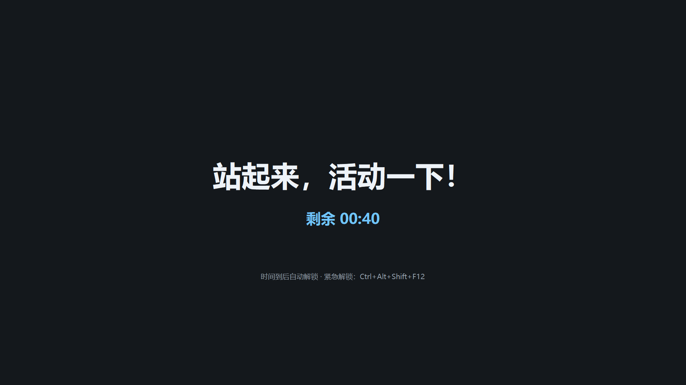

# Liftly
站会儿

[English](README.en.md) | 中文

站会儿（Liftly）是一个 Windows 桌面常驻小工具：工作一段时间后自动锁住键盘和鼠标，用全屏深色遮罩盖住所有显示器；休息时间到后自动解锁。程序只有一个 `liftly.exe`，不联网，常驻系统托盘。

## 适用人群：腰疼患者福音

长时间久坐、腰背容易酸痛的人，常常是忘了起身活动。站会儿会按你设定的节奏，每隔一段时间强制你离开座位，让腰背有机会放松。它不能治疗腰疼，也不能替代医生的诊断和康复指导；如果腰痛持续或加重，请及时就医。

## 功能

- 锁定前在屏幕右下角弹出提醒窗口并每秒倒计时（点击可关闭；弹窗创建失败时退回托盘气泡）。
- 默认在工作区右上角显示紧凑的置顶倒计时气泡（96 DPI、100% 约 134×32）：默认浅绿色底、绿色细边和小圆角，单行每秒更新“距休息 MM:SS”，右侧为 Liftly 图标；暂停时显示“已暂停 MM:SS”并采用对应皮肤的暂停配色，休息和锁屏时自动隐藏，不抢焦点。鼠标移到气泡边缘出现双向箭头后拖动可调整大小（50%–300%），中间拖动仍是移动；松开后自动夹到最近的显示器工作区并保存到 INI；可在托盘菜单关闭、调整大小、切换皮肤（清新绿/天空蓝/暖橙/深色/樱花粉）并持久化。
- 休息时枚举所有显示器，每个显示器创建一个置顶全屏遮罩，居中显示提醒语和休息倒计时。
- 休息期间通过低级键盘/鼠标钩子阻止输入；时间到后自动解锁。
- 托盘右键菜单支持工作、休息及提醒时长的预设档位，以及气泡大小（小/标准/大/较大/特大）和气泡皮肤（清新绿/天空蓝/暖橙/深色/樱花粉）；“自定义…”或“设置…”可输入任意合法时长并调整解锁开关，也可双击托盘图标打开设置。
- 所有界面支持中英文：在设置窗口的“界面语言”中选择“English”并保存后，托盘菜单、托盘提示和气泡通知、设置窗口、提醒弹窗、错误对话框、桌面气泡和锁屏遮罩立即切换为英文，当前计时不会重置；选择“跟随系统”则按 Windows 显示语言自动选择。
- 锁屏期间暂停计时；解锁或睡眠唤醒后重新开始一个完整工作周期。
- 支持紧急解锁：休息中同时按住 Ctrl、Alt、Shift（左右均可）再按 F12 提前结束休息（默认开启，可配置关闭）。
- 使用单调时钟和单个 `SetTimer` 事件驱动，空闲时不轮询。

## 截图

工作中的桌面倒计时气泡（`docs/images/bubble.png`）：


休息时的全屏遮罩（`docs/images/lock-screen.png`，单块显示器）：



## 运行

下载或自行构建后，把 `liftly.exe` 放在任意目录，双击运行即可。程序没有主窗口，启动后常驻托盘；约 1 秒内会显示“站会儿已启动”气泡，提示当前工作/休息时长，并说明右键托盘可设置、双击可打开设置；同时工作区右上角出现倒计时气泡。启动失败（例如主窗口或托盘图标创建失败）时会弹出错误对话框，不会静默退出。退出时使用托盘右键菜单中的“退出”。

配置文件 `liftly.ini` 必须和 `liftly.exe` 放在同一目录。文件不存在时使用默认配置；未知配置项和非法值会被忽略。

在托盘修改设置后会立即生效并保存到 `liftly.ini`，保留注释和其他配置；不会将未修改的命令行覆盖项写回。工作中会重新计时，暂停中保持暂停并重置工作时长，当前休息不受影响。拖动气泡只保存位置，拖动边缘缩放只保存大小和（左上角有变化时）位置，都不会重置计时；托盘菜单的“显示桌面倒计时”、“气泡大小”和“气泡皮肤”只影响气泡显示，同样不会重置计时。保存失败时仍会显示托盘气泡，本次运行依旧生效。设置窗口打开期间计时照常进行，到点休息会关闭窗口并丢弃未保存的修改。

## 配置项

| 键 | 默认值 | 范围 | 说明 |
| --- | --- | --- | --- |
| `work_minutes` | `45` | `1..=600` | 工作时长（分钟） |
| `break_minutes` | `5` | `1..=120` | 休息时长（分钟） |
| `warn_seconds` | `60` | `0..=600` | 锁定前提醒秒数；`0` 表示不提醒。若大于等于工作时长，会自动截断为工作时长减 1 秒 |
| `reset_on_unlock` | `true` | `true/false` | 锁屏期间暂停计时，解锁或睡眠唤醒后重新开始一个完整工作周期 |
| `emergency_unlock` | `true` | `true/false` | 休息期间是否允许同时按住 Ctrl、Alt、Shift（左右均可）再按 F12 紧急解锁 |
| `show_bubble` | `true` | `true/false` | 是否显示桌面倒计时气泡；休息和锁屏时始终隐藏 |
| `bubble_position` | `auto` | `auto` 或 `x,y` | 气泡左上角坐标；`auto` 表示工作区右上角。拖动后自动保存，越界位置会夹回可见工作区 |
| `bubble_scale` | `100` | `50..=300` | 气泡大小百分比；`100` 为标准大小。托盘菜单可切换 80/100/125/150/200 档位，也可拖动气泡边缘调整 |
| `bubble_theme` | `green` | `green`/`blue`/`orange`/`dark`/`pink` | 气泡皮肤；托盘菜单可切换清新绿、天空蓝、暖橙、深色、樱花粉，非法值忽略 |
| `language` | `auto` | `auto`/`zh`/`en` | 界面语言。`auto` 跟随 Windows 显示语言（中文系统用中文，其他用英文）。托盘菜单、设置窗口、提醒弹窗、错误对话框、桌面气泡和锁屏遮罩全部随此设置切换，可在设置窗口的“界面语言”中修改。保存其他设置时不会自动追加这一行 |

`liftly.ini` 使用简单的 `key = value` 格式，`#` 或 `;` 开头的行是注释。示例见同目录的 `liftly.ini.example`：

```ini
# 工作时长（分钟），1-600
work_minutes = 45

# 休息时长（分钟），1-120
break_minutes = 5

# 锁定前提醒秒数，0-600；0 表示不提醒
warn_seconds = 60

# 锁屏期间暂停计时，解锁或睡眠唤醒后是否重新开始一个完整工作周期
reset_on_unlock = true

# 是否允许同时按住 Ctrl、Alt、Shift（左右均可）再按 F12 紧急解锁
emergency_unlock = true

# 是否显示桌面倒计时气泡
show_bubble = true

# 气泡位置：auto（工作区右上角）或 x,y（例如 1200,80），拖动后自动保存
bubble_position = auto

# 气泡大小百分比，50-300；100 为标准大小
bubble_scale = 100

# 气泡皮肤：green/blue/orange/dark/pink
bubble_theme = green

# 界面语言：auto（跟随 Windows）/ zh / en；全部界面随此设置切换，可在设置窗口修改
language = auto
```

## 命令行参数

命令行参数会覆盖 `liftly.ini` 中的同名配置：

```text
liftly.exe --work 45 --break 5 --warn 60
```

也支持 `--work=45` 的写法。非法值或越界值会被忽略，保留文件/默认值。

## 开机自启

在托盘打开设置窗口，勾选“开机自启动”并保存即可。下次登录 Windows 时会自动运行。该选项写入当前用户的注册表 Run 项（`HKCU\Software\Microsoft\Windows\CurrentVersion\Run` 下的 `Liftly`），不需要管理员权限，也不会写入 `liftly.ini`。

移动 `liftly.exe` 后需要重新打开设置并勾选一次，以便更新启动路径。

如果以前在“启动”文件夹放过快捷方式，建议删掉，避免开机启动两次。即使不删，带 `--autostart` 的第二个实例也会静默退出，不会再弹出“站会儿已经在运行”。

## 资源占用

- 实测：内存占用不到 2 MB，CPU 占用率小于 1%。
- 整个程序只有一个隐藏消息窗口、一个托盘图标、一个桌面倒计时气泡和按需创建的提醒弹窗、遮罩窗口。
- 主循环只使用一个 `SetTimer`：显示桌面气泡的工作阶段每秒刷新倒计时；关闭气泡后工作阶段最长每 60 秒醒来一次刷新托盘提示；锁定前提醒倒计时阶段每秒刷新弹窗和托盘提示；休息阶段每秒刷新倒计时；不进行高频轮询。启动阶段另有一个短定时器延迟显示启动提示，托盘就绪或退出后立即释放。
- 遮罩和倒计时气泡绘制均使用 GDI 双缓冲，字体、画刷、区域、位图和内存 DC 在每次绘制后释放，不会随秒数累积泄漏。
- Release 构建使用 `opt-level = "z"`、LTO、单 codegen unit、`panic = "abort"` 和 strip，生成体积较小的单文件程序。

## 图标

图标资产位于 `assets/` 目录：

- `assets/liftly.svg`：矢量母版（`256×256` viewBox），用于 32px 及以上尺寸的设计。
- `assets/liftly.ico`：Windows 多尺寸图标，包含 16、20、24、32、40、48、64 和 256 共 8 个尺寸；256 帧为 PNG，其余为 32 位 BMP。
- `assets/liftly.png`：`256×256` 预览图。

设计采用从 `#3DDC97` 到 `#0B7A75` 的青绿渐变圆角方块，中间是白色举手伸展的站立小人，外围环绕半透明计时圆弧；计时圆弧仅在 40px 及以上绘制。24px 及以下的底板铺满画布，并使用单独绘制的小人几何，避免头部和手部粘连，因此小尺寸并非直接由 SVG 缩放而来。

重新生成需要 Python 3 和 Pillow：

```bash
python3 tools/gen_icon.py
# 可选：额外输出深浅背景对照预览图（不要提交到仓库）
python3 tools/gen_icon.py --preview /tmp/liftly-icon-preview.png
```

修改设计时需同步修改 `tools/gen_icon.py` 和 `assets/liftly.svg`。

构建时会自动将多尺寸图标嵌入 `liftly.exe`，资源管理器、托盘和窗口使用同一套 Liftly 图标，无需随 exe 分发 `assets/`。资源生成器使用纯 Rust，交叉编译和 Windows 本机构建均不需要额外安装资源编译器。

## 构建

```bash
cargo zigbuild --release --target x86_64-pc-windows-gnu
# 产物：target/x86_64-pc-windows-gnu/release/liftly.exe
```

Windows 本机可直接 `cargo build --release`（产物 `target\release\liftly.exe`）。

完整的环境搭建步骤见 [docs/BUILD.md](docs/BUILD.md)。

## 已知限制

- `Ctrl+Alt+Del` 安全序列由系统直接处理，任何普通程序都无法屏蔽；它也是系统层面的最终兜底。
- 本程序以普通权限运行时，低级钩子无法拦截以管理员权限运行的窗口中的输入（Windows 的 UIPI 限制）。
- 远程桌面会话、锁屏界面和登录界面不受本程序遮罩影响。
- 如果两个钩子都安装失败，遮罩仍会显示，但输入不会被拦截；此时需等待休息结束。
- 桌面倒计时气泡的卡片区域会接收鼠标：中间拖动移动位置，边缘拖动调整大小；点到卡片时不会穿透到下方窗口，圆角外的透明区域仍然穿透。位置保存在 `liftly.ini` 的 `bubble_position`，大小保存在 `bubble_scale`，皮肤保存在 `bubble_theme`，显示器拔插或分辨率变化后会自动夹回最近的工作区。
- 不要同时运行多个副本；程序使用命名互斥量保证单实例，第二个实例只会提示“站会儿已经在运行”。
- 所有界面文案（托盘菜单、设置窗口、提醒弹窗、错误对话框、桌面气泡和锁屏遮罩）都支持中英文，可在设置窗口的“界面语言”或 `language` 中切换。
